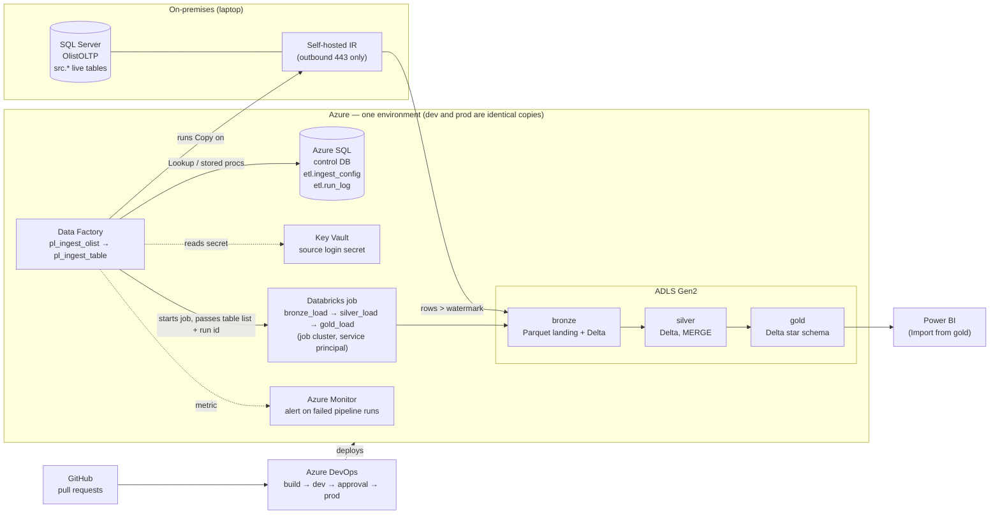
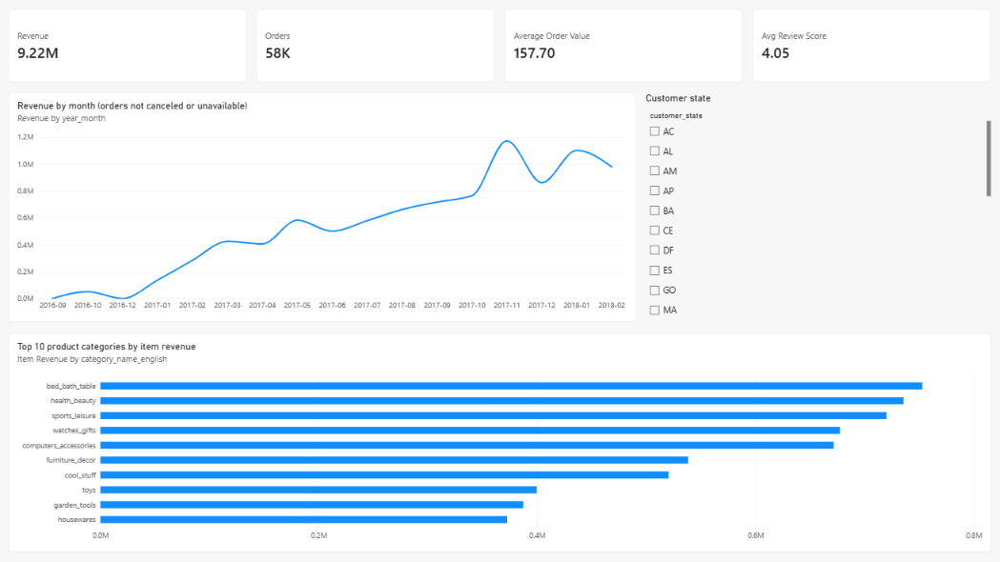
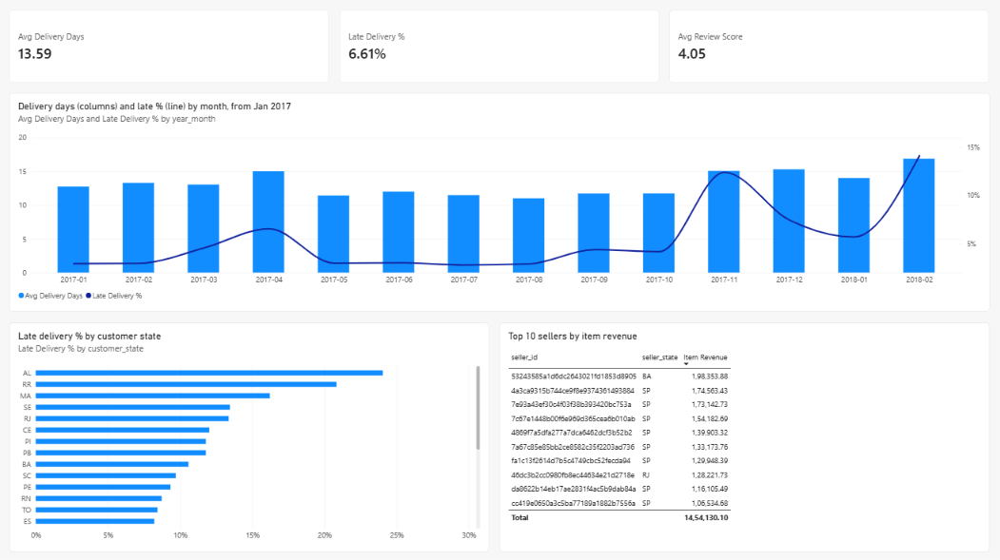
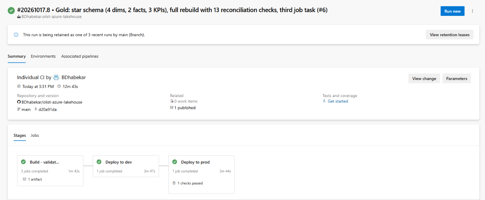
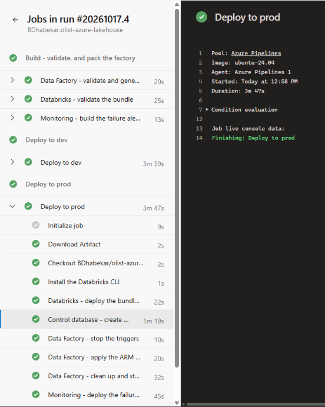
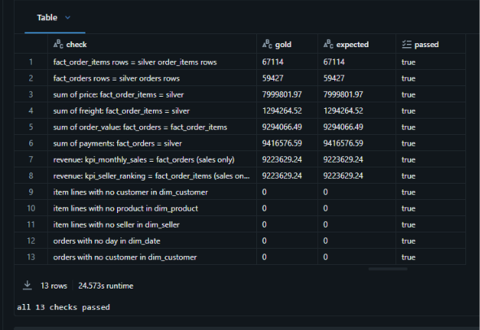
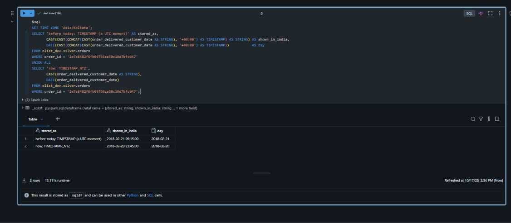

# Olist E-commerce Lakehouse on Azure

An end-to-end, incremental data platform on Azure. Data from an **on-premises SQL Server** is copied by **Azure Data Factory** through a self-hosted integration runtime into **ADLS Gen2**. An **Azure Databricks** job then loads it through **bronze → silver → gold** Delta tables in **Unity Catalog**, and **Power BI** reports on the gold star schema. Every change reaches production through a pull request and an **Azure DevOps** pipeline that deploys to two separate environments, dev and prod. A failed pipeline run sends an alert mail.

All transformations are **SQL on Databricks** (Spark SQL / Delta Lake). Python only reads the parameters, assembles the statements and loops the same SQL over the list of tables.

| Area | What |
|---|---|
| Source | SQL Server 2025 on a laptop, standing in for the on-premises network. The Brazilian E-Commerce Public Dataset by Olist: 9 tables, 1.55 M rows of history, replayed month by month as live business |
| Ingestion | Azure Data Factory with a self-hosted integration runtime. Watermark-based incremental copy driven by a control table, with a run log and a watermark per table |
| Lakehouse | Azure Databricks, Delta Lake, Unity Catalog external tables, medallion layers (bronze / silver / gold) |
| Serving | A gold star schema (4 dimensions, 2 facts, 3 KPI tables) and a Power BI report (Import mode) |
| Delivery | GitHub → Azure DevOps YAML pipeline → dev, then prod after approval. ARM templates for Data Factory, a Databricks Asset Bundle for the job, Bicep for monitoring |
| Proven | First load: 343,844 rows in 8 tables, equal to the source, in dev and in prod. 13 gold-to-silver reconciliation checks fail the run if any one breaks. A deliberately failed run sent the alert mail 2 min 45 s after it failed |

---

## Architecture


<details>
<summary>The same architecture as a Mermaid diagram (text)</summary>



</details>

**Who moves the bytes.** The self-hosted runtime on the source machine reads SQL Server and writes Parquet straight into the lake over outbound HTTPS. No inbound port is opened on the database. Data Factory in the cloud only tells the runtime what to do. Its control tables live in an Azure SQL database, never in the source system being read.

---

## How one run works

1. **`pl_ingest_olist`** (parent) reads the list of tables from `etl.ingest_config` — the single list of tables for the whole platform — and runs **`pl_ingest_table`** once per table.
2. **`pl_ingest_table`**:
   - looks up the new upper watermark *before* copying;
   - copies only the rows changed since the last watermark into `bronze/olist/<table>/load_date=…/` as Parquet;
   - moves the watermark only *after* the copy succeeds.

   Reference tables with no timestamp are copied whole each run. Every table run writes one row to `etl.run_log`: on success, and on a failure of the watermark lookup, the copy or the watermark update, with a null-safe error message. The failure then fails the pipeline on purpose, so it is never swallowed. A failure in the parent itself (its control-table lookup, the Databricks job) is caught by the failure alert.
3. The parent starts the Databricks job **`job_olist_lakehouse_<env>`** with a *Databricks Job* activity (`job_lakehouse_load`). The activity signs in with the factory's managed identity, not a token, and hands over the pipeline run id and the table list, so one id links the copy, the bronze load and the silver load.
4. The job runs three tasks on one job cluster that exists only for the run:
   - **`bronze_load`**: `COPY INTO` each bronze Delta table. `COPY INTO` remembers the files it has loaded, so a re-run loads 0 rows. Lineage columns: `_source_file`, `_source_file_time`, `_loaded_at`. One audit row per table.
   - **`silver_load`**: reads only the bronze rows after the table's **bookmark**. Rows that break a NOT NULL or CHECK rule go to **`silver.quarantine`** with the rule's name. The load keeps the newest row per business key, then runs a **`MERGE`** that inserts new keys and updates a row only when the incoming one is newer (for reference tables, only when its stored row hash changed). It then checks that no key is held twice — and fails the table if one is — writes an audit row, and only then moves the bookmark forward. Run twice, it changes nothing.
   - **`gold_load`**: rebuilds the star schema from silver with `INSERT OVERWRITE`, then runs **13 reconciliation checks**: row counts; price, freight and payment totals; KPI revenue against the facts; orphan keys against every dimension. Any mismatch raises an error: the job fails, the pipeline fails and the alert mails.
5. **`tr_daily_ingest`** is a daily schedule trigger, defined and deployed in both environments. It is **kept stopped to save cost** (every load so far was started deliberately) and is switched on through a pull request, never in the portal.

---

## The layers

| Layer | What one table holds | How it is written | Tables |
|---|---|---|---|
| **bronze** | everything as received, plus lineage columns | `COPY INTO` (idempotent by file) | 8 source tables + `load_audit` |
| **silver** | one row per business key, typed and constrained (39 NOT NULL columns, 6 CHECK value rules, source times as `TIMESTAMP_NTZ`) | bookmark window → quarantine → dedup → `MERGE` | 8 tables + `geolocation` (defined, not loaded) + `quarantine`, `load_state` (the bookmarks), `load_audit` |
| **gold** | a star schema for reporting | full rebuild + reconciliation | `dim_customer` 59,427 · `dim_product` 32,951 · `dim_seller` 3,095 · `dim_date` 543 · `fact_order_items` 67,114 · `fact_orders` 59,427 · `kpi_monthly_sales` · `kpi_delivery_by_state` · `kpi_seller_ranking` |

**Business keys** (found by a grain census, because the source declares none):

| Table | Key |
|---|---|
| orders | `order_id` |
| order_items | `order_id, order_item_id` |
| order_payments | `order_id, payment_sequential` |
| order_reviews | `review_id, order_id` |
| customers | `customer_id` |
| products | `product_id` |
| sellers | `seller_id` |
| product_category_translation | `product_category_name` |

**Gold model.** There are two facts at two grains, so neither is fanned out by the other:
- `fact_order_items`: one row per item, for product and seller analysis;
- `fact_orders`: one row per order, with order value, payments, delivery days, late flag and review score.

Both facts join only through dimensions. `dim_customer` is keyed on `customer_id`, the id an order carries, and keeps `customer_unique_id`, the id of the person.

---

## Power BI report

Import mode from `<catalog>.gold` through the Azure Databricks connector, so no cluster has to stay up while people use the report. The report is versioned as a **Power BI Project (`.pbip`)**: the report as PBIR and the model as TMDL, both text, so a change can be reviewed in a pull request. The `.pbix` binary, which holds the data, is not committed.

- **Model:** six relationships — the four dimensions to the two facts — every one one-to-many and single-direction, dimension to fact; no fact-to-fact relationship. `dim_date` is the marked date table, so Power BI's automatic date tables are switched off.
- **Measures:** Revenue, Orders, Average Order Value, Item Revenue, Avg Delivery Days, Late Delivery %, Avg Review Score. Orders that were canceled or unavailable are excluded from the sales measures; the delivery measures count delivered orders only.




---

## Environments and CI/CD

| | dev | prod |
|---|---|---|
| Resource group | `rg-olist-dev` | `rg-olist-prod` |
| Data Factory | `adf-olist-dev-bd`, the only factory connected to Git, with Publish disabled | `adf-olist-prod-bd`, never edited by hand |
| Storage · Key Vault · control DB | own copies | own copies |
| Databricks workspace · catalog | `dbw-olist-dev` · `olist_dev` | `dbw-olist-prod` · `olist_prod` |
| Job runs as | `sp-olist-lakehouse-dev` | `sp-olist-lakehouse-prod` |
| Deploys as | `id-olist-deploy-dev` | `id-olist-deploy-prod` |

One self-hosted runtime is shared from `rg-olist-shared` (a linked runtime in each factory), because the laptop can host only one runtime node.

**The pipeline (`azure-pipelines.yml`).** Every pull request runs the build. A merge to `main` runs build → dev → prod.

- **build:**
  - validates the factory and generates its ARM template with Microsoft's `@microsoft/azure-data-factory-utilities` — "automated publish": no Publish button and no `adf_publish` branch;
  - checks that every value that differs between dev and prod is a template parameter;
  - runs `databricks bundle validate`;
  - builds the alert's Bicep.
- **deploy_dev → deploy_prod** use the same template, `cicd/templates/deploy-environment.yml`. The prod stage waits for an **approval** on the `olist-prod` environment. Each stage:
  1. deploys the Databricks bundle and reads the job id;
  2. creates or updates schema `etl` in the control database, waiting for the serverless database to wake;
  3. stops the triggers;
  4. applies the ARM template with that environment's values;
  5. cleans up and restarts the triggers meant to run;
  6. deploys the failure alert.

Every tool the pipeline installs is pinned — the agent image, Node.js, the Data Factory build package (with a lock file), the Databricks CLI and Bicep — so a deployment changes only when the repository does.



<details>
<summary>The steps of one deployment</summary>



</details>

**Authentication without secrets in the pipeline.** Azure DevOps signs in to Azure with **workload identity federation**, one service connection per environment. Each deployment identity has rights in its own environment only; the pull-request build signs in as dev's identity, so a pull request can never reach prod. Pull requests from forks are not built.

**Branching.** Short-lived feature branches, squash-merged; GitHub deletes the merged branch. A ruleset on `main` requires a pull request with a green build check and blocks force pushes. The dev factory has *Publish* disabled, so it changes only through Git — and, with the rule on `main`, only through a pull request.

---

## Security and access

- **No keys, SAS tokens or personal access tokens anywhere:**
  - Data Factory uses its managed identity for the lake, the vault, the control database and the Databricks workspace;
  - Databricks reaches storage through an Access Connector and Unity Catalog external locations;
  - the only secret is the source SQL login's password, which lives in Key Vault (RBAC model).
- **Least privilege in Unity Catalog** (`nb_uc_grants`). The load's service principal gets `USE`, `SELECT`, `MODIFY` and, in bronze only, `CREATE TABLE`, plus `READ FILES` and `CREATE EXTERNAL TABLE` on the landing location. It cannot drop, alter or re-grant a silver or gold table, or write loose files. It does own the bronze tables, because the load creates each one the first time it meets it (named under *Known gaps*). Silver and gold definitions (`nb_silver_setup`, `nb_gold_setup`) are applied by the catalog owner.
- Each catalog is **bound to its own workspace**.
- The source login `adf_reader` is **read-only** on schema `src`.

**Who may do what** — the same in dev and in prod; no identity of one environment holds anything in the other:

| Identity | Access | On | Why |
|---|---|---|---|
| Data Factory (its managed identity) | Storage Blob Data Contributor | the storage account | writes the landed Parquet files |
| | Key Vault Secrets User | the Key Vault | reads the source login's password |
| | Contributor | the Databricks workspace | starts the job |
| | a database user with `SELECT` and `EXECUTE` on schema `etl` | the control database | reads the list of tables, writes the run log and the watermarks |
| | sharing permission | the shared self-hosted runtime | reaches the source |
| Access Connector (its managed identity) | Storage Blob Data Contributor | the storage account | Databricks reads and writes the lake (the Unity Catalog storage credential) |
| Deployment identity (user-assigned managed identity) | Contributor | its environment's resource group | deploys the factory and the alert |
| | `db_owner` | the control database | creates and updates schema `etl` |
| | **Use** on the job's service principal; manages the job | the Databricks workspace | deploys the job to run as that principal |
| Azure DevOps | a federated credential | the deployment identity | signs in without a secret |
| The job's service principal | the Unity Catalog grants above | the catalog and the landing location | runs the load |

---

## Monitoring

`monitoring/alerts.bicep` creates, per environment:
- an action group `ag-olist-<env>-failures`;
- a metric alert `alert-olist-<env>-pipeline-failed` on the factory's **PipelineFailedRuns > 0**, over a 5-minute window, evaluated every minute. Severity is 3 in dev and 1 in prod.

The mail receiver is a secret pipeline variable. **Proven:** a deliberately failing triggered run fired the alert (Fired, then Resolved). Debug runs do not emit this metric, so the proof had to be a triggered run.

---

## Key design decisions

| Decision | Choice | Rejected, and why |
|---|---|---|
| On-prem access | Self-hosted IR, outbound 443 only | Opening an inbound port / public endpoint on the database |
| Where control metadata lives | Azure SQL control database | Inside the source system, which you don't own |
| Incremental ingestion | Watermark on `modified_at`. Upper bound read before the copy, saved after success. Timestamps passed to procedures as strings | Full reload every run. A `DateTime` parameter lost a millisecond and would have re-copied rows every run |
| Type conversion in the copy | A conversion that would cut data fails the copy (`allowDataTruncation` off) | Data Factory's default, which truncates silently |
| Landing format | Parquet (snappy) in `load_date=` folders | CSV: no types, no schema |
| Silver write | Delta `MERGE` on the grain-census key, newest row per key, newer-only update guard | Append (duplicates on re-run). Overwrite (slow, loses history) |
| Silver read | Bookmark on `_loaded_at` | *Named exception:* the Databricks standard is a streaming checkpoint — Auto Loader / Structured Streaming in PySpark, or a SQL streaming table, which runs on its own serverless pipeline. This project keeps plain SQL on a classic job cluster, for cost |
| Bad rows | Quarantine with the broken rule; good rows still load | Dropping silently. Failing the whole load for one row |
| Reference tables | Stored row hash; update only on a real content change | Rewriting every row every run |
| Source times | `TIMESTAMP_NTZ`: the source stores local time with no zone | `TIMESTAMP`, which shifts the value by the session time zone |
| Gold refresh | Full rebuild + 13 reconciliation checks that fail the run | Incremental gold. At about 225,000 rows a rebuild is a handful of SQL statements and cannot drift |
| Fact grain | Two facts (item, order); payments summed per order | One fact joining payments to items, where the fan-out inflates revenue |
| Compute | Job cluster defined in the job (single node, D4s_v3). Development on a small all-purpose cluster with auto-stop | Serverless notebooks: measured far more expensive for this workload |
| Job identity | A service principal per environment | A person's account |
| Orchestration | One Databricks job started by Data Factory's *Databricks Job* activity | One Notebook activity per notebook |
| Environments | Separate resource group, factory, storage, vault, control DB, workspace, catalog and identity per environment | One environment, or prod in the same workspace |
| Factory deployment | ARM template generated by the build | The Publish button and `adf_publish` |
| Pinned tools | Agent image, Node.js, build package (lock file), Databricks CLI and Bicep pinned in the repository | "latest", where a deployment can change because a tool did |
| Power BI | Import mode, `.pbip` in Git | DirectQuery (cluster must stay up). `.pbix` in Git (binary, holds data) |

---

## Numbers

- **First load, dev and prod** (each its own triggered run, about 15 minutes):
  - orders 59,427 · customers 59,427 · order_items 67,114 · order_payments 62,386 · order_reviews 59,373 · products 32,951 · sellers 3,095 · category translation 71;
  - **343,844 rows**, every count equal to the source, 0 duplicate keys, 0 quarantined.
- **Incremental proof** (during development, in the single environment that came before dev and prod):
  - replaying February 2018 added 6,728 new orders on top of existing silver rows;
  - changing one order at the source updated exactly that row in silver;
  - a re-run changed nothing.

  In dev, after the move to `TIMESTAMP_NTZ`, one more changed order again updated exactly one row.
- **Gold:** 13 of 13 checks passed in dev and prod, with every number equal between the two (prod below):

  
- **Time zones:** the source stores local time with no zone. Stored as `TIMESTAMP`, an order delivered at 2018-02-20 23:45 showed as 2018-02-21 05:15 in an India session and landed on the wrong day. Stored as `TIMESTAMP_NTZ` it stays 2018-02-20 23:45 in any session:

  
- **A data-quality finding the checks surfaced:** payments (9,416,576.59 BRL) exceed order value (9,294,066.49 BRL) by 122,510.10 BRL. Measured on an earlier copy of the same data, nearly all of the gap is 622 orders that were paid but have no item lines in the source (canceled or unavailable); a small part is card-instalment interest. So the report's revenue is order value — item price plus freight, for orders not canceled or unavailable — not payments.

## Cost

This ran on an Azure for Students subscription.

- The first full load (Data Factory plus one single-node job cluster) cost **at most about ₹30 (well under US$1)** on the meter; a run with gold adds a few minutes of the same cluster.
- Between runs the platform costs almost nothing: the job cluster exists only during a run, the control databases are serverless on the free offer, and there is no SQL warehouse.
- The one expensive lesson came early: developing notebooks on Serverless interactive compute cost about ₹3,000 (about US$35) in three days. Development moved to a small cluster with auto-stop, and every compute choice since has been made with its price first.

---

## Known gaps (deliberate, named)

| Gap | Why it is not in this version | The design when built |
|---|---|---|
| **Deletes at the source** | A timestamp watermark cannot see a deleted row | SQL Server change tracking, read by Data Factory, and a delete branch (`WHEN NOT MATCHED BY SOURCE` / soft delete) in the silver `MERGE` |
| **Retention** | Full-load reference tables are re-copied each run; bronze holds `products` once per run | Change detection at ingestion (copy only when the hash changes), old full-load copies removed from bronze, an ADLS lifecycle rule on landing files, scheduled `VACUUM` |
| `geolocation` | 1 M rows, no key and no consumer in gold | Not loaded in dev or prod (`active = 0` in `etl.ingest_config`); its silver table is defined and empty. It becomes a gold table (one point per zip prefix) if a map is needed |
| Bronze tables owned by the load identity | The load creates a bronze table the first time it meets one | Bronze tables created by the set-up step; the load gets `MODIFY` only |
| Storage open to all networks, shared-key access on, RA-GRS replication | Portal defaults, on a lab subscription with no private network | Private endpoints or a firewall; shared-key access off (every access here is by identity); replication chosen for the recovery need |
| Workspaces without secure cluster connectivity | *No Public IP* = No, so no NAT gateway is billed while idle | Secure cluster connectivity (No Public IP) with VNet injection and private endpoints to storage |
| One runtime node on a laptop | Lab constraint | Self-hosted IR on always-on servers, 2+ nodes for high availability |
| `trustServerCertificate = true` | The laptop's SQL Server has a self-signed certificate | A CA-issued certificate with validation on |
| One reviewer | Solo project: I approve my own pull requests | Required reviews from a second engineer |
| One Unity Catalog metastore for dev and prod | One metastore per region is the Databricks model | Same — isolation comes from a catalog per environment bound to its own workspace, which this project does |
| Set-up notebooks run by hand | `nb_uc_bootstrap`, `nb_silver_setup`, `nb_gold_setup` change table definitions and run as the catalog owner, once per environment | A schema-migration step in the pipeline, running as a dedicated owner identity |
| Daily schedule stopped | Cost on a student subscription; every load was started deliberately | Schedule on, through a pull request |

## What changes at 100× the data

- **Ingestion:** a multi-node self-hosted IR on servers; copies parallelized per table and partitioned within large tables; change tracking or CDC instead of watermarks where the source allows it.
- **Bronze → silver:** Auto Loader / Structured Streaming with a checkpoint instead of the SQL bookmark; liquid clustering on the keys; scheduled `OPTIMIZE` / `VACUUM`.
- **Gold:** incremental, driven by silver's change data feed with a `MERGE` of changed orders, instead of a full rebuild.
- **Orchestration:** the loads read the control table themselves instead of receiving it as a parameter (parameter size limits at hundreds of tables). Per-table failure isolation with a retry queue.
- **Serving:** a Databricks SQL warehouse for Power BI refresh, with incremental refresh on the fact tables.

---

## Repository layout

```
adf/                    Data Factory as the dev factory writes it in Git mode: pipelines, datasets,
                        linked services, trigger, integration runtime. publish_config.json is Data
                        Factory's own file: Publish is disabled, so the branch it names is never created
databricks/             Databricks Asset Bundle: databricks.yml, the job, and the notebooks (.py)
  nb_uc_bootstrap.py    external locations, catalog, schemas — once per environment
  nb_uc_grants.py       least-privilege grants for the load's service principal
  nb_silver_setup.py    silver table definitions (owner-run)
  nb_gold_setup.py      gold table definitions (owner-run)
  nb_bronze_load.py     task 1
  nb_silver_load.py     task 2
  nb_gold_load.py       task 3 + reconciliation
sql/local-source/       the on-premises source: database, live tables, seed, month-replay procedure,
                        read-only login, checks, and three one-row change scripts used by the proofs
sql/control-db/deploy/  the control database: schema etl (config, run log, watermark procedures),
                        applied by the pipeline; and the user script the server's Entra admin runs once
scripts/                load_olist.py loads the 9 Olist CSVs into the source database (requirements.txt)
cicd/                   pipeline template, per-environment variables, deployment scripts,
                        the Data Factory build package
monitoring/alerts.bicep failure alert
powerbi/                the report as a Power BI Project (.pbip)
docs/images/            the pictures in this README
azure-pipelines.yml     build → dev → prod
```

## How it was built

Built in October 2026, in two steps. First a single environment — ingestion, bronze, silver and the job — each piece proven with real runs. Then dev and prod were created new, side by side, and filled only by the pipeline; every change since has gone through a [pull request](https://github.com/BDhabekar/olist-azure-lakehouse/pulls?q=is%3Apr+is%3Aclosed). The repository's first commits still show the Data Factory of that first environment, practice objects included; they were removed in `f61fed7`.

I built this with an AI assistant (Claude) as mentor and pair-programmer. The design decisions, the Azure build, and every run and check are mine; much of the code — notebooks, SQL scripts, pipeline YAML — was drafted with the assistant and reviewed and run by me.

## Reproducing it

1. **Source:** download the [Olist dataset](https://www.kaggle.com/datasets/olistbr/brazilian-ecommerce) and `pip install -r scripts/requirements.txt` (plus Microsoft ODBC Driver 18 for SQL Server). On a SQL Server, run `sql/local-source/01` to `07` in order (`08` is an optional backup). `02` loads the CSVs; `04` and `05` seed history up to 2017-12-31 and create `etl.usp_replay_month`, which replays one month as new business (`05` ends with two red errors on purpose: its own guard tests). Step `06`'s login is created in SSMS first, and its password goes into Key Vault only.
2. **Azure, once:** a resource group holding one Data Factory that hosts the self-hosted runtime (installed on the source machine) and the two deployment identities, each with a federated credential for Azure DevOps. Register the resource provider `microsoft.insights`.
3. **Azure, per environment:** resource group, storage account (hierarchical namespace; containers `bronze`, `silver`, `gold`, `ucmanaged`), Key Vault holding the source password as `sql-olist-adf-reader-password`, Azure SQL server and control database, Data Factory (with the shared runtime granted to it), and a Databricks workspace (Premium) with an Access Connector. Give each identity the access in *Who may do what*; the server's Microsoft Entra admin runs `sql/control-db/deploy/<env>_bootstrap_users.sql` once.
4. **Unity Catalog, per environment:** register the Access Connector as a storage credential, create the job's service principal, then run as the catalog owner `nb_uc_bootstrap` → `nb_silver_setup` → `nb_gold_setup` → `nb_uc_grants`, and bind the catalog to its workspace.
5. **Pipeline:** point an Azure DevOps pipeline at `azure-pipelines.yml`. Put your resource names in `cicd/variables/`. In Azure DevOps, create the service connections `sc-olist-dev` and `sc-olist-prod` (workload identity federation), the environments `olist-dev` and `olist-prod` (an approval on prod), and the pipeline variables `subscriptionId`, `devRunAsSpAppId`, `prodRunAsSpAppId` and the secret `alertEmail`. Merging to `main` deploys everything else; the first load is one triggered run of `pl_ingest_olist`.
6. **Power BI:** open `powerbi/olist-gold.pbip`, then *Transform data → Data source settings → Change Source…*, and give your workspace's server hostname and a cluster's HTTP path (the file holds this project's prod workspace). If sign-in fails with *"User canceled authentication"*, turn off *Options → Security → enhanced sign-in experience*.

## Data and licence

Brazilian E-Commerce Public Dataset by Olist ([Kaggle](https://www.kaggle.com/datasets/olistbr/brazilian-ecommerce)), licensed CC BY-NC-SA 4.0. No data is stored in this repository.

The code is under the MIT licence — see [LICENSE](LICENSE). The icons in the architecture picture are [Tabler Icons](https://github.com/tabler/tabler-icons) (MIT licence).
