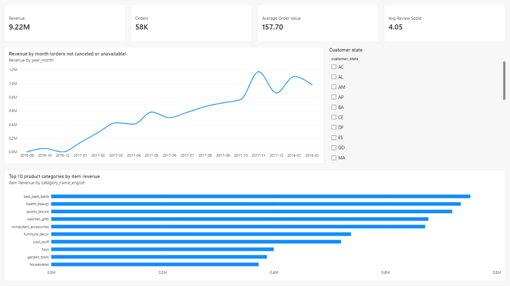
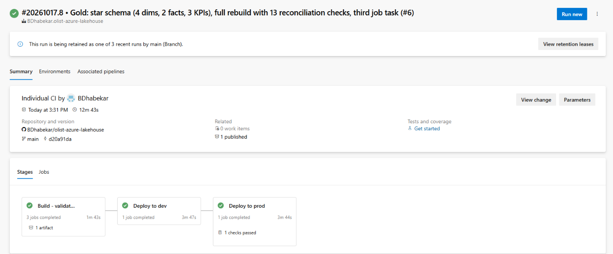

# Olist e-commerce lakehouse on Azure

This is an incremental data platform I built on Azure in October 2026. SQL Server 2025 on my laptop plays the on-premises source. Azure Data Factory copies new and changed rows into ADLS Gen2, an Azure Databricks job loads them through bronze, silver and gold Delta tables in Unity Catalog, and a Power BI report reads gold. There are two environments, dev and prod, and a change reaches them only through a pull request and an Azure DevOps pipeline.

The data is the Brazilian E-Commerce Public Dataset by Olist: 9 tables, 1.55 million rows. The source starts with the history up to the end of 2017, and I replay later months one at a time so the pipeline always has new business to pick up. Every transformation is SQL on Databricks. Python only reads the parameters and runs the same SQL for each table.


## One run, start to finish

1. Data Factory reads the list of tables from a control database. For each table it asks the source for the rows changed since the last watermark and writes them to the lake as Parquet. The copy runs on a self-hosted runtime on the source machine, so nothing in Azure ever connects in to the database. The watermark moves only after the copy has succeeded.
2. The bronze task loads each landed file once with `COPY INTO` and stamps every row with the file it came from and the time it was loaded.
3. The silver task sends rows that break a rule to a quarantine table, keeps the newest row per business key and merges the result. If a key ends up in a table twice, that table fails.
4. The gold task builds the star schema from silver, runs 13 reconciliation checks on it, and writes the tables only if all 13 pass.

If a step fails, the pipeline fails and an alert mail is sent. The error text is kept: in a run log for the copy, and in audit tables for the bronze and silver loads. Running again is safe: silver and gold come out the same. Bronze is the exception, because it takes a fresh copy of the three reference tables on every run (one of the known gaps below).

The details are in [docs/how-it-works.md](docs/how-it-works.md).

## What I measured

- First load, in dev and again in prod: 343,844 rows in 8 tables. Every count matched the source, with 0 duplicate keys and 0 rows in quarantine.
- All 13 gold checks passed in both environments, and every number was the same in dev and in prod.
- A run I failed on purpose sent the alert mail 2 minutes 45 seconds after it failed.
- The first full load cost at most about ₹30 (well under US$1) on the meter.

The incremental behaviour was proven earlier, in the single environment I built before dev and prod existed. Replaying February 2018 added 6,728 orders on top of the rows already in silver. Changing one order at the source changed exactly that row in silver, and a second run changed nothing.

The checks also turned up something in the data. Payments come to 122,510.10 BRL more than order value. Measured on an earlier copy of the same data, nearly all of that gap is 622 orders that were paid but have no item lines in the source. That is why the report counts revenue as order value and leaves payments out of it.

These numbers are from version 1.0. [CHANGELOG.md](CHANGELOG.md) lists what version 1.1 changed and how far each change has been run. The evidence pictures and the cost detail are in [docs/numbers-and-cost.md](docs/numbers-and-cost.md).



## Design choices

| Question | What I chose | What I turned down |
|---|---|---|
| How does Azure reach a database inside a private network? | A self-hosted runtime on the source machine that only makes outbound connections on port 443 | Opening an inbound port or a public endpoint on the database |
| How are new rows found? | A watermark on `modified_at`, read before the copy, saved after it, and kept two minutes behind the clock | A full reload every run. A watermark with no lag, which can skip a row whose transaction commits late |
| How is silver written? | A `MERGE` on the business key that updates a row only when the incoming one is newer | Append, which doubles rows on a re-run. Overwrite, which is slow and loses history |
| What happens to a bad row? | It goes to a quarantine table with the name of the rule it broke, and the good rows still load | Dropping it silently. Failing the whole load for one row |
| When is gold written? | After the 13 checks have passed | Writing first and checking afterwards, which puts wrong numbers in the report before the alert arrives |
| What compute does it use? | A job cluster that exists only for the run, and a small auto-stop cluster for development | Serverless notebooks, which I measured as far more expensive for this workload |
| How is it deployed? | An ARM template generated by the build, with Azure DevOps signing in through workload identity federation | The Publish button in Data Factory. A secret stored in the pipeline |

All 22 decisions are in [docs/design-decisions.md](docs/design-decisions.md).

## Getting a change to prod

A pull request runs the build. It validates the Data Factory files, the Databricks bundle and the alert template, and it runs the tests in `tests/`, which execute the real gold notebook on a handful of made-up orders. After the merge the pipeline deploys to dev, waits for my approval, and then deploys the same package to prod.



Dev and prod have separate resource groups, factories, storage accounts, Key Vaults, control databases, Databricks workspaces, catalogs and identities. They share three things: the runtime on the laptop, the Unity Catalog metastore and the subscription. The project holds no keys, SAS tokens or personal access tokens. Its one secret is the source database password, which is kept in Key Vault.

More in [docs/environments-and-cicd.md](docs/environments-and-cicd.md) and [docs/security-and-access.md](docs/security-and-access.md).

## What it doesn't do yet

I left these out knowingly. [docs/known-gaps.md](docs/known-gaps.md) has the design for each one and what I would change at 100 times the data.

- It can't see a delete at the source. A timestamp watermark only finds rows that still exist.
- It never removes anything. Bronze keeps every copy of the reference tables it has ever received.
- The network is open. Storage accepts all networks and the workspaces have no private endpoints, because a student subscription has no private network to put them in.
- The source is a single laptop with a self-signed certificate.
- The daily schedule is deployed but switched off to save cost, so I have started every load by hand.
- I approve my own pull requests.

## More detail

- [How it works](docs/how-it-works.md): one run in detail, the layers, the business keys, the report model
- [Design decisions](docs/design-decisions.md): all 22, each with what was turned down
- [Numbers and cost](docs/numbers-and-cost.md)
- [Environments, CI/CD and monitoring](docs/environments-and-cicd.md)
- [Security and access](docs/security-and-access.md): who may do what
- [Runbook](docs/runbook.md): starting a load, reading a failure, releasing quarantined rows, rolling back
- [Known gaps](docs/known-gaps.md)
- [Reproducing it](docs/reproduce.md)
- [Changelog](CHANGELOG.md)

## Repository layout

```
adf/                    Data Factory as the dev factory writes it in Git mode: pipelines, datasets,
                        linked services, trigger, integration runtime
databricks/             Databricks Asset Bundle: databricks.yml, the job, and the notebooks (.py)
sql/local-source/       the on-premises source: database, tables, seed, month-replay procedure,
                        read-only login, checks, and three one-row change scripts used by the proofs
sql/control-db/deploy/  the control database: schema etl (config, run log, watermark procedures),
                        applied by the pipeline
scripts/                load_olist.py loads the 9 Olist CSVs into the source database
cicd/                   pipeline template, per-environment variables, deployment scripts,
                        the Data Factory build package
monitoring/alerts.bicep the failure alert
powerbi/                the report as a Power BI Project (.pbip)
tests/                  the gold notebook run on made-up rows; checks on the definitions
docs/                   the pages listed above, and the pictures
azure-pipelines.yml     build, then dev, then prod
```

## How I built it

I built it in two steps. The first was a single environment with ingestion, bronze, silver and the job, each piece proven with real runs. Then I created dev and prod from scratch, side by side, and filled them only through the pipeline. Every change since has gone through a [pull request](https://github.com/BDhabekar/olist-azure-lakehouse/pulls?q=is%3Apr+is%3Aclosed). The repository's first commits still show the Data Factory of that first environment, practice objects included. I removed them in `f61fed7`.

I worked with an AI assistant (Claude) as mentor and pair-programmer. The design decisions, the Azure build, and every run and check are mine. Much of the code (notebooks, SQL scripts, pipeline YAML) was drafted with the assistant, then reviewed and run by me.

## Data and licence

Brazilian E-Commerce Public Dataset by Olist ([Kaggle](https://www.kaggle.com/datasets/olistbr/brazilian-ecommerce)), licensed CC BY-NC-SA 4.0. No data is stored in this repository.

The code is under the MIT licence; see [LICENSE](LICENSE). The icons in the architecture picture are [Tabler Icons](https://github.com/tabler/tabler-icons) (MIT licence).
