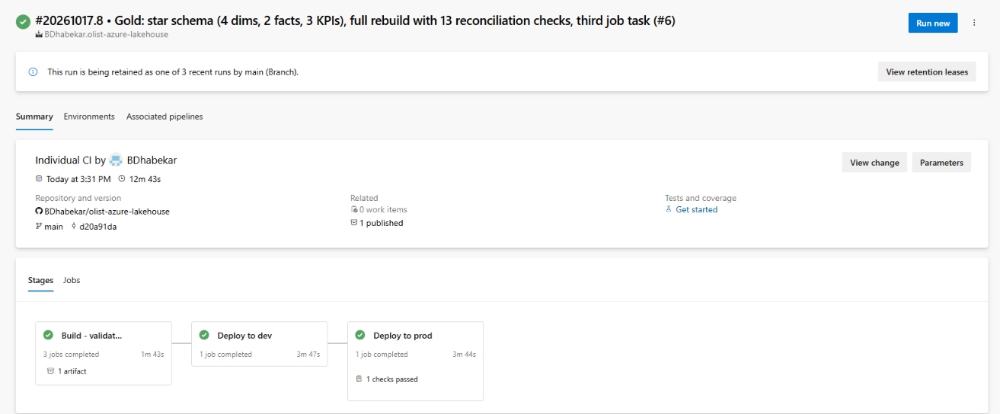
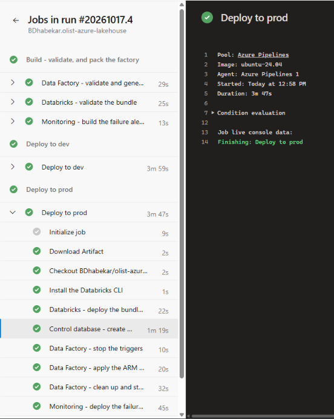

# Environments, CI/CD and monitoring

[Back to the README](../README.md)

## The two environments

| | dev | prod |
|---|---|---|
| Resource group | `rg-olist-dev` | `rg-olist-prod` |
| Data Factory | `adf-olist-dev-bd`, the only factory connected to Git, with Publish disabled | `adf-olist-prod-bd`, never edited by hand |
| Storage, Key Vault, control database | its own | its own |
| Databricks workspace and catalog | `dbw-olist-dev`, `olist_dev` | `dbw-olist-prod`, `olist_prod` |
| The job runs as | `sp-olist-lakehouse-dev` | `sp-olist-lakehouse-prod` |
| Deployments run as | `id-olist-deploy-dev` | `id-olist-deploy-prod` |

One self-hosted runtime is shared from `rg-olist-shared`, as a linked runtime in each factory, because the laptop can host only one runtime node.

## The pipeline

`azure-pipelines.yml` has three stages. Every pull request runs the build. A merge to `main` runs the build, then dev, then prod.

The build does five things:

1. It validates the factory and generates its ARM template with Microsoft's `@microsoft/azure-data-factory-utilities` package. This is "automated publish": nobody presses the Publish button and there is no `adf_publish` branch.
2. It checks that every value that differs between dev and prod is a parameter of that template. Otherwise prod would quietly keep dev's value.
3. It runs `databricks bundle validate`.
4. It compiles the alert's Bicep.
5. It runs the tests in `tests/` on the build machine's own Spark: the real `nb_gold_load` notebook on made-up rows, and checks on the pipeline and notebook files. No workspace or cluster is involved.

The two deploy stages use the same template, `cicd/templates/deploy-environment.yml`. The prod stage waits for an approval on the `olist-prod` environment. Each stage:

1. deploys the Databricks bundle and reads the job id;
2. creates or updates schema `etl` in the control database, waiting first for the serverless database to wake;
3. stops the triggers;
4. applies the ARM template with that environment's values;
5. cleans up and restarts the triggers that are meant to run;
6. deploys the failure alert.

The pipeline pins most of what it installs: the agent image, Node.js, the Data Factory build package (with a lock file), the Databricks CLI, Bicep, and Python with the test packages. Two things are not pinned yet. The two trigger steps ask for the latest Azure PowerShell, and the control-database step installs the `SqlServer` PowerShell module without a version. Until those are fixed, a deployment can still change because a tool did.

The steps of one deployment:

## Signing in without secrets

Azure DevOps signs in to Azure with workload identity federation, through one service connection per environment. Each deployment identity has rights in its own environment only. The pull-request build signs in as dev's identity, so a pull request can never reach prod. Pull requests from forks are not built.

## Branching

I use short-lived feature branches and squash-merge them. GitHub deletes the merged branch. A ruleset on `main` requires a pull request with green build checks, the tests among them, and blocks force pushes. The dev factory has Publish disabled, so it changes only through Git, and with the rule on `main` that means only through a pull request.

## Monitoring

`monitoring/alerts.bicep` creates two things in each environment:

- an action group, `ag-olist-<env>-failures`;
- a metric alert, `alert-olist-<env>-pipeline-failed`, on the factory's `PipelineFailedRuns > 0` over a 5-minute window, evaluated every minute. Severity is 3 in dev and 1 in prod.

The mail receiver is a secret pipeline variable. I proved the alert with a triggered run that I made fail: it fired and later resolved. Debug runs do not emit this metric, so the proof had to be a triggered run.

What to do when the alert arrives is in the [runbook](runbook.md).
