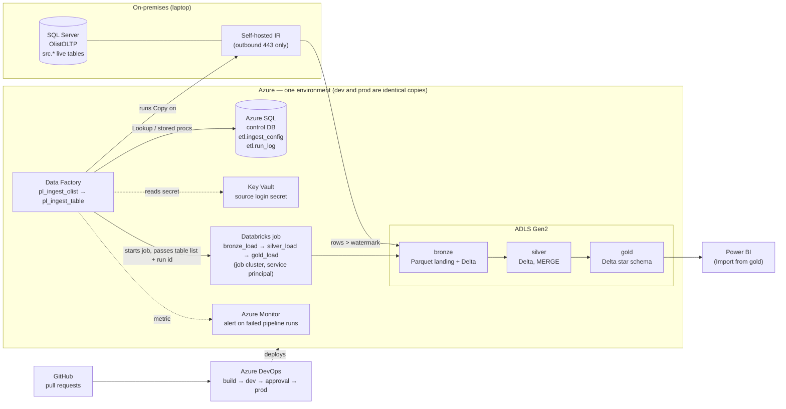
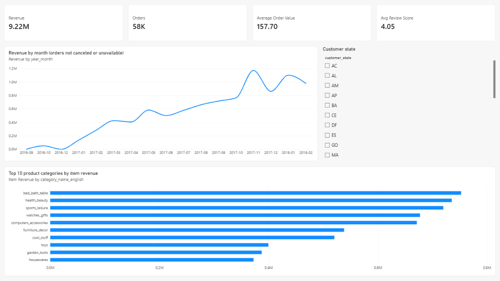
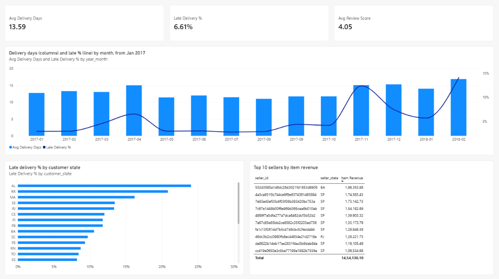

# How it works

[← back to the README](../README.md)

The architecture as a diagram, one run step by step, what each layer holds, and the report model.

## Architecture

The same architecture as text:

**Who moves the bytes.** The self-hosted runtime on the source machine reads SQL Server and writes Parquet straight into the lake over outbound HTTPS. No inbound port is opened on the database. Data Factory in the cloud only tells the runtime what to do. Its control tables live in an Azure SQL database, never in the source system being read.

## How one run works

1. **`pl_ingest_olist`** (parent) reads the list of tables from `etl.ingest_config` — the single list of tables for the whole platform — and runs **`pl_ingest_table`** once per table.
2. **`pl_ingest_table`**:
   - looks up the new upper watermark *before* copying: the newest change that is at least two minutes old (`p_lag_seconds`, 120), so a transaction still being written at the source is left for the next run instead of being skipped for good;
   - copies only the rows changed since the last watermark into `bronze/olist/<table>/load_date=…/` as Parquet;
   - moves the watermark only *after* the copy succeeds.

   Reference tables with no timestamp are copied whole each run. Every table run writes one row to `etl.run_log`: on success, and on a failure of the watermark lookup, the copy or the watermark update, with a null-safe error message. The failure then fails the pipeline on purpose, so it is never swallowed. The watermark lookup, the copy and the watermark update are each retried twice, a minute apart; a retried copy writes the same file name again, so nothing is doubled. Only one run of the parent pipeline is active at a time. A failure in the parent itself (its control-table lookup, the Databricks job) is caught by the failure alert.
3. The parent starts the Databricks job **`job_olist_lakehouse_<env>`** with a *Databricks Job* activity (`job_lakehouse_load`). The activity signs in with the factory's managed identity, not a token, and hands over the pipeline run id and the table list, so one id links the copy, the bronze load and the silver load.
4. The job runs three tasks on one job cluster that exists only for the run:
   - **`bronze_load`**: `COPY INTO` each bronze Delta table. `COPY INTO` remembers the files it has loaded, so a re-run loads 0 rows. Lineage columns: `_source_file`, `_source_file_time`, `_loaded_at`. One audit row per table. A table that fails does not stop the others; the task fails at its end, and silver does not start.
   - **`silver_load`**: reads only the bronze rows after the table's **bookmark**. Rows that break a NOT NULL or CHECK rule go to **`silver.quarantine`** with the rule's name. The load keeps the newest row per business key, then runs a **`MERGE`** that inserts new keys and updates a row only when the incoming one is newer (for reference tables, only when its stored row hash changed). It then checks that no key is held twice — and fails the table if one is — writes an audit row, and only then moves the bookmark forward. Run twice, it changes nothing. A table that fails keeps its bookmark and does not stop the others; the task fails at its end, and gold does not start.
   - **`gold_load`**: works out the star schema from silver as temporary views, then runs **13 reconciliation checks** on them: row counts; price, freight and payment totals; KPI revenue against the facts; orphan keys against every dimension. Only when all 13 pass are the nine tables written with `INSERT OVERWRITE`. A mismatch raises an error before anything is written: gold keeps its last good load, the job fails, the pipeline fails and the alert mails.
5. **`tr_daily_ingest`** is a daily schedule trigger, defined and deployed in both environments. It is **kept stopped to save cost** (every load so far was started deliberately) and is switched on through a pull request, never in the portal.

## The layers

| Layer | What one table holds | How it is written | Tables |
|---|---|---|---|
| **bronze** | everything as received, plus lineage columns | `COPY INTO` (idempotent by file) | 8 source tables + `load_audit` |
| **silver** | one row per business key, typed and constrained (39 NOT NULL columns, 6 CHECK value rules, source times as `TIMESTAMP_NTZ`) | bookmark window → quarantine → dedup → `MERGE` | 8 tables + `geolocation` (defined, not loaded) + `quarantine`, `load_state` (the bookmarks), `load_audit` |
| **gold** | a star schema for reporting | full rebuild + reconciliation | `dim_customer` 59,427 · `dim_product` 32,951 · `dim_seller` 3,095 · `dim_date` 543 · `fact_order_items` 67,114 · `fact_orders` 59,427 · `kpi_monthly_sales` · `kpi_delivery_by_state` · `kpi_seller_ranking` |

**Business keys** (found by a grain census, because the source declares none):

| Table | Key |
|---|---|
| orders | `order_id` |
| order_items | `order_id, order_item_id` |
| order_payments | `order_id, payment_sequential` |
| order_reviews | `review_id, order_id` |
| customers | `customer_id` |
| products | `product_id` |
| sellers | `seller_id` |
| product_category_translation | `product_category_name` |

**Gold model.** There are two facts at two grains, so neither is fanned out by the other:
- `fact_order_items`: one row per item, for product and seller analysis;
- `fact_orders`: one row per order, with order value, payments, delivery days, late flag and review score.

Both facts join only through dimensions. `dim_customer` is keyed on `customer_id`, the id an order carries, and keeps `customer_unique_id`, the id of the person.

## Power BI report

Import mode from `<catalog>.gold` through the Azure Databricks connector, so no cluster has to stay up while people use the report. The report is versioned as a **Power BI Project (`.pbip`)**: the report as PBIR and the model as TMDL, both text, so a change can be reviewed in a pull request. The `.pbix` binary, which holds the data, is not committed.

- **Model:** six relationships — the four dimensions to the two facts — every one one-to-many and single-direction, dimension to fact; no fact-to-fact relationship. `dim_date` is the marked date table, so Power BI's automatic date tables are switched off.
- **Measures:** Revenue, Orders, Average Order Value, Item Revenue, Avg Delivery Days, Late Delivery %, Avg Review Score. Orders that were canceled or unavailable are excluded from the sales measures; the delivery measures count delivered orders only.

