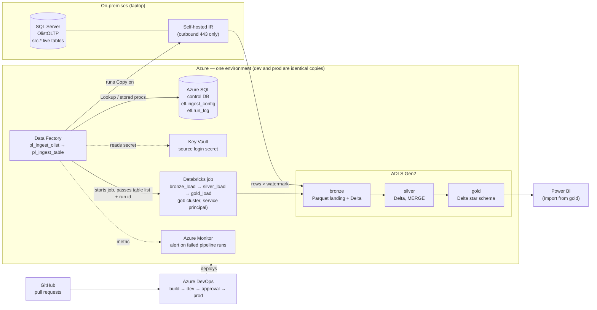

# How it works

[Back to the README](../README.md)

## The picture

The same thing as text:

The self-hosted runtime on the source machine does the copying. It reads SQL Server and writes Parquet straight into the lake over outbound HTTPS, so no inbound port is opened on the database. Data Factory in the cloud only tells the runtime what to do. Its control tables live in an Azure SQL database of their own, never in the source system it reads from.

## One run in detail

### 1. Data Factory copies what changed

The parent pipeline `pl_ingest_olist` reads the active tables from `etl.ingest_config` in the control database. That table is the single list of tables for the whole platform. The parent then runs `pl_ingest_table` once per table, four at a time.

For a table that carries `modified_at`, the child pipeline does three things in order:

1. It asks the source for the new upper watermark: the newest `modified_at` that is at least two minutes old. A row is stamped before its transaction commits, so without the two-minute lag (`p_lag_seconds`) a row that commits late could end up behind the watermark and never be copied.
2. It copies the rows above the old watermark, up to and including the new one, into `bronze/olist/<table>/load_date=…/` as Parquet.
3. It saves the new watermark, and only if the copy succeeded.

Three reference tables (`products`, `sellers`, `product_category_translation`) have no timestamp, so they are copied whole on every run.

Each table run writes one row to `etl.run_log`. On a failure of the lookup, the copy or the watermark update, the row carries the error message, and the child pipeline then fails on purpose so the failure is never swallowed. Those three steps are retried twice, a minute apart. A retried copy writes the same file again, so nothing is doubled. Only one run of the parent pipeline is active at a time.

### 2. Data Factory starts the Databricks job

When every table has been copied, the parent starts `job_olist_lakehouse_<env>` with a Databricks Job activity (`job_lakehouse_load`). The activity signs in with the factory's managed identity, with no token involved. It hands over the pipeline run id and the table list, so one id links the copy, the bronze load and the silver load.

The job runs three tasks on one job cluster that exists only for the run.

### 3. Bronze

`bronze_load` runs `COPY INTO` for each bronze Delta table. `COPY INTO` remembers the files it has loaded, so loading the same file twice adds 0 rows. Each row gets three lineage columns: `_source_file`, `_source_file_time` and `_loaded_at`. The task writes one audit row per table.

If a table fails, the others still load. The task fails at its end and silver does not start.

### 4. Silver

For each table, `silver_load`:

1. reads only the bronze rows loaded after the table's bookmark;
2. sends rows that break a NOT NULL or CHECK rule to `silver.quarantine`, with the name of the rule;
3. keeps the newest row per business key;
4. runs a `MERGE` that inserts new keys and updates an existing row only when the incoming one is newer. For reference tables it also requires that the stored row hash has changed;
5. checks that no key is held twice, and fails the table if one is;
6. writes an audit row, and only then moves the bookmark forward.

Run twice over the same data, it changes nothing. A table that fails keeps its bookmark and does not stop the other tables. The task fails at its end and gold does not start.

### 5. Gold

`gold_load` works out all nine gold tables from silver as temporary views. It then runs 13 reconciliation checks on those views: row counts; totals of price, freight and payments; KPI revenue against the facts; orphan keys against every dimension.

If all 13 pass, the nine tables are written with `INSERT OVERWRITE`. If one fails, the task raises an error before writing anything. Gold keeps its last good load, the job fails, the pipeline fails and the alert mail is sent.

### The schedule

`tr_daily_ingest` is a daily schedule trigger, defined and deployed in both environments. It is kept stopped to save cost, and every load so far was started by hand. It is switched on by pull request, never in the portal.

## What each layer holds

| Layer | What one table holds | How it is written | Tables |
|---|---|---|---|
| bronze | everything as received, plus lineage columns | `COPY INTO`, which loads each file once | 8 source tables and `load_audit` |
| silver | one row per business key, typed and constrained (39 NOT NULL columns, 6 CHECK rules, source times as `TIMESTAMP_NTZ`) | bookmark window, quarantine, newest row per key, `MERGE` | 8 tables, plus `geolocation` (defined, not loaded), `quarantine`, `load_state` (the bookmarks) and `load_audit` |
| gold | a star schema for reporting | full rebuild, checked before it is written | `dim_customer` 59,427 · `dim_product` 32,951 · `dim_seller` 3,095 · `dim_date` 543 · `fact_order_items` 67,114 · `fact_orders` 59,427 · `kpi_monthly_sales` · `kpi_delivery_by_state` · `kpi_seller_ranking` |

## Business keys

The source declares no keys, so I found them with a grain census: for each table, which columns identify exactly one row.

| Table | Key |
|---|---|
| orders | `order_id` |
| order_items | `order_id, order_item_id` |
| order_payments | `order_id, payment_sequential` |
| order_reviews | `review_id, order_id` |
| customers | `customer_id` |
| products | `product_id` |
| sellers | `seller_id` |
| product_category_translation | `product_category_name` |

## The gold model

Gold has two facts at two grains, so neither one multiplies the other:

- `fact_order_items` has one row per item, for product and seller analysis.
- `fact_orders` has one row per order, with order value, payments, delivery days, a late flag and the review score.

The two facts join only through dimensions. `dim_customer` is keyed on `customer_id`, the id an order carries, and it keeps `customer_unique_id`, the id of the person.

## The Power BI report

The report uses Import mode from `<catalog>.gold` through the Azure Databricks connector, so no cluster has to stay up while people use it. It is versioned as a Power BI Project (`.pbip`), with the report as PBIR and the model as TMDL. Both are text, so a change can be reviewed in a pull request. The `.pbix` binary, which holds the data, is not committed.

The model has six relationships, from the four dimensions to the two facts. Each one is one-to-many and filters in one direction, from dimension to fact. There is no relationship between the two facts. `dim_date` is the marked date table, so Power BI's automatic date tables are switched off.

There are seven measures: Revenue, Orders, Average Order Value, Item Revenue, Avg Delivery Days, Late Delivery % and Avg Review Score. The sales measures leave out orders that were canceled or unavailable. The delivery measures count delivered orders only.

