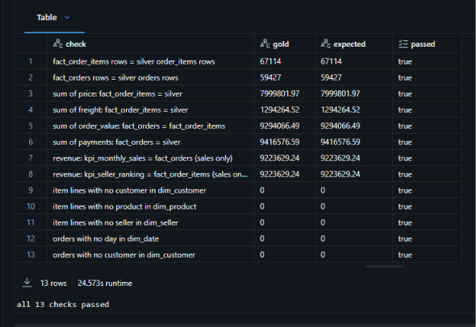
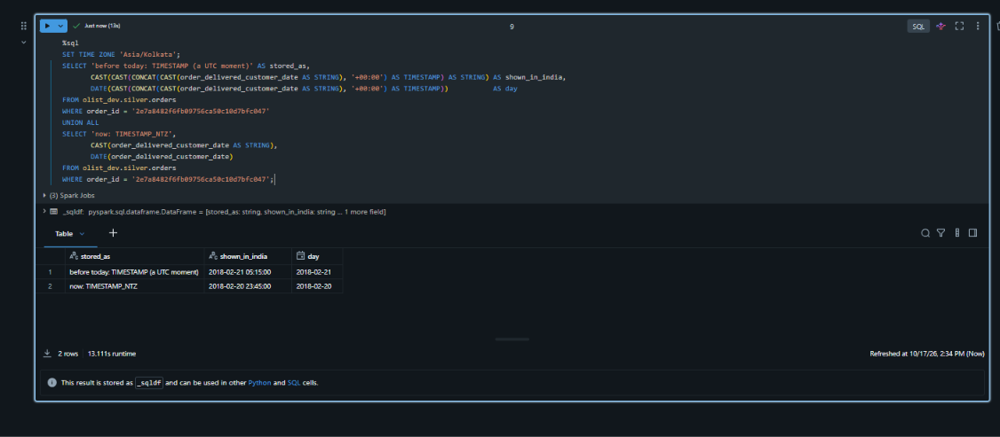

# Numbers and cost

[Back to the README](../README.md)

These runs are from version 1.0 (October 2026). [CHANGELOG.md](../CHANGELOG.md) lists what has changed since and how far each change has been run.

## First load, dev and prod

Each environment was loaded by its own triggered run of about 15 minutes.

| Table | Rows |
|---|---|
| orders | 59,427 |
| customers | 59,427 |
| order_items | 67,114 |
| order_payments | 62,386 |
| order_reviews | 59,373 |
| products | 32,951 |
| sellers | 3,095 |
| product_category_translation | 71 |
| Total | 343,844 |

Every count equals the source. There were 0 duplicate keys and 0 quarantined rows.

## Incremental proof

I did this during development, in the single environment that came before dev and prod.

- Replaying February 2018 added 6,728 new orders on top of the rows already in silver.
- Changing one order at the source updated exactly that row in silver.
- A re-run changed nothing.

Later, in dev, after the move to `TIMESTAMP_NTZ`, one more changed order again updated exactly one row.

## Gold

13 of 13 checks passed in dev and in prod, and every number was equal between the two. This is prod:

## Time zones

The source stores local time with no zone. Stored as `TIMESTAMP`, an order delivered at 2018-02-20 23:45 showed as 2018-02-21 05:15 in an India session and landed on the wrong day. Stored as `TIMESTAMP_NTZ` it stays 2018-02-20 23:45 in any session.

## A finding in the data

Payments (9,416,576.59 BRL) exceed order value (9,294,066.49 BRL) by 122,510.10 BRL. Measured on an earlier copy of the same data, nearly all of the gap is 622 orders that were paid but have no item lines in the source (canceled or unavailable). A small part is card-instalment interest. The report therefore counts revenue as order value: item price plus freight, for orders that were not canceled or unavailable.

## Version 1.1 in dev

On November 12, 2026 I loaded dev once on version 1.1. The pipeline and its job succeeded. With no new orders at the source, the run took 25 minutes from trigger to end, against about 15 for the first load of version 1.0. I have not yet found out which task the extra time went to.

## Cost

This ran on an Azure for Students subscription.

The first full load (Data Factory plus one single-node job cluster) cost at most about ₹30 (well under US$1) on the meter. A run with gold adds a few minutes of the same cluster.

Between runs the platform costs almost nothing. The job cluster exists only during a run, the control databases are serverless on the free offer, and there is no SQL warehouse.

I made one expensive mistake early on. Developing notebooks on Serverless interactive compute cost about ₹3,000 (about US$35) in three days. I moved development to a small cluster with auto-stop, and since then I have looked at the price before choosing any compute.
